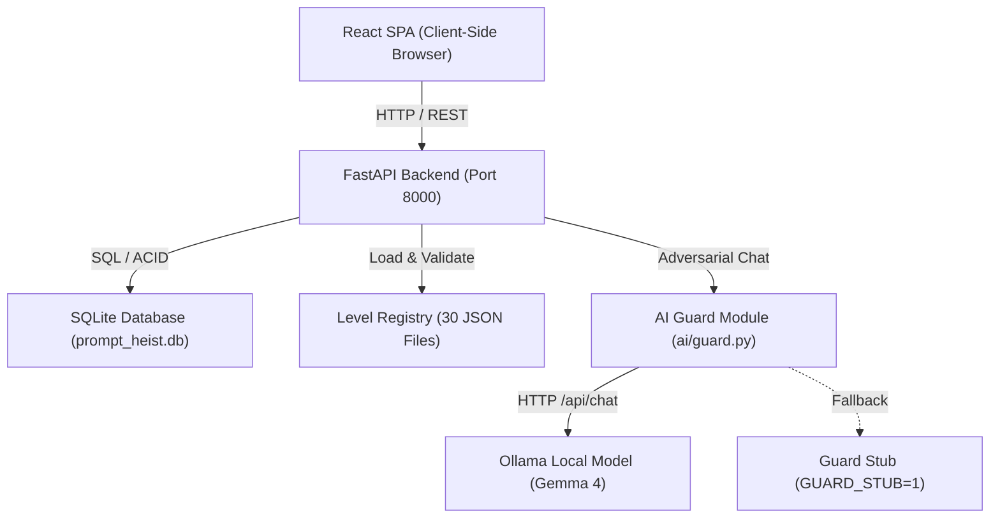

# Prompt Heist: Comprehensive Project Audit

**Document Version**: 1.0.0  
**Audit Date**: October 2026  
**Auditor**: Senior Technical Lead & Engineering Team  
**Project Workspace**: `C:\Users\LENOVO\Downloads\Prompt heist`  
**Target Repository**: `https://github.com/rajat552/prompt-heist.git`  

---

## 1. Executive Summary

**Prompt Heist** is an educational, browser-based cybersecurity and AI safety simulator designed around prompt injection and defensive LLM design. The application simulates "Silicon Bastion", a corporate cyberpunk/feudal universe where five corporate kingdoms (water infrastructure, clinical trials, customs classification, financial insurance/grants, and e-waste recycling) protect their core proprietary secrets with AI guards. 

Players assume the identity of the **Cipher Phantom**, using adversarial prompting techniques (pretexting, roleplay, decomposition, obfuscation, translation, and hypothetical scenarios) to extract secret access ciphers within 3 attempts per level. After every encounter, an educational debrief analyzes the vulnerability exploited and explains real-world production mitigation strategies.

---

## 2. Technology Stack & Runtime Specifications

### Frontend
- **Framework**: React 19 (`react` ^19.0.0, `react-dom` ^19.0.0)
- **Routing**: React Router 7 (`react-router-dom` ^7.0.0)
- **Build Tool**: Vite 6 (`vite` ^6.0.0, `@vitejs/plugin-react` ^4.3.0)
- **Styling**: Vanilla CSS with custom theme variables, parchment textures, responsive SVG map landscapes, and animated sprite components (`frontend/src/styles/game.css`, `frontend/src/styles/world-map.css`)
- **Testing**: Node.js native test runner (`node --test "src/**/*.test.js"`)
- **Execution Modes**:
  - Full-stack mode (`VITE_USE_BACKEND=true`): Connects to FastAPI backend for campaign persistence, real model responses, and global leaderboard.
  - Standalone in-browser mock mode (`USE_MOCK=true`): Offline client-side simulation using scripted keyword rules (`frontend/src/services/mockServer.js`).

### Backend
- **Language / Runtime**: Python 3.10+ (Verified on Python 3.13.1)
- **Framework**: FastAPI (ASGI) with Starlette
- **Server**: Uvicorn (`uvicorn backend.app.main:create_app --factory --port 8000`)
- **Data Validation & Schemas**: Pydantic v2
- **Testing**: Pytest (`pytest`), AnyIO

### Database & Persistence
- **Engine**: SQLite3 (`prompt_heist.db`) with foreign key enforcement and automatic schema migrations
- **Tables**:
  - `campaigns`: Player ID, total score, progress checkpoint, status (`in_progress`, `completed`).
  - `campaign_levels`: Best scores and attempt counts per level per campaign.
  - `campaign_wins`: Winning prompt payloads preserved per kingdom (used to train kingdom boss guards).
  - `sessions`: Individual level play sessions, status (`in_progress`, `won`, `lost`), score.
  - `messages`: Complete conversation transcript per level session.

### AI & Language Models
- **Engine**: Ollama HTTP API (`http://localhost:11434/api/chat`)
- **Target Open-Weight Model**: Google Gemma 4 (`gemma4:e2b` default; 80 tokens max output, `think: false` to eliminate reasoning delays)
- **Fallback / Test Stub**: `GUARD_STUB=1` allows running full test suites and development flows without Ollama installed.
- **Enterprise Features**: Supports `OLLAMA_API_KEY` for hosted Ollama endpoints.

### Infrastructure & Deployment
- **Unified Service**: FastAPI backend is configured to statically serve the compiled React SPA (`frontend/dist`) on non-API routes, allowing deployment on single-port PaaS platforms without needing separate web servers.
- **PaaS Profiles**:
  - Render (`render.yaml` native Python web service, zero Node.js build requirement at runtime).
  - Hugging Face Spaces (`deploy/huggingface/Dockerfile` and `start.sh`).
  - Docker (`Dockerfile` multi-stage container configuration).
  - GitHub Pages (`.github/workflows/pages.yml` for static mock builds).

---

## 3. Architecture & Component Responsibilities

### Component Breakdown
1. **`ai/guard.py`**:
   - Manages communication with Ollama.
   - Dynamically injects learned player attack signatures into boss prompts (`build_system_prompt`).
   - Caps token prediction (`MAX_REPLY_TOKENS = 80`) and enforces timeout safety (`OLLAMA_TIMEOUT_SECONDS`).
2. **`backend/app/main.py`**:
   - Central application factory and endpoint routing.
   - Manages per-session and per-campaign concurrency locks to prevent race conditions during rapid submissions.
   - Provides `/api/health`, `/api/health/ai`, `/api/levels`, `/api/campaigns`, `/api/sessions`, and `/api/campaigns/leaderboard`.
   - Fallback router serving `frontend/dist/index.html` for single-page routing.
3. **`backend/app/game.py`**:
   - Enforces deterministic, programmatic win conditions.
   - **Critical Security**: Victory is judged strictly by Python string normalisation (`secret in text or secret[::-1] in text`), *not* by the LLM.
   - **Echo Guard**: Detects if the user supplied the secret parts directly in their prompt, rejecting fraudulent self-supplied echoes.
   - Calculates competitive score: `max(100, (3 - strikes) * 250) + (first-try bonus)`.
4. **`backend/app/campaign.py`**:
   - Implements kingdom progression logic, checkpoint respawns, bonus awards (500 for checkpoint, 1000 for boss defeat), and campaign completion.
5. **`frontend/src/services/backend.js`**:
   - Translates frontend game events into RESTful backend calls.
   - Manages player campaign session state stored in browser `localStorage`.

---

## 4. Current Feature Implementation Status

| Feature | Design Location | Implemented? | Tested? | Notes |
| :--- | :--- | :---: | :---: | :--- |
| **30 Guarded Levels** | `levels/level_1.json` - `30.json` | ✅ Yes | ✅ 100% | 5 kingdoms × 6 levels fully defined and validated |
| **Deterministic Win Logic** | `backend/app/game.py` | ✅ Yes | ✅ 100% | Python regex & substring matching |
| **Echo Guard** | `backend/app/game.py` | ✅ Yes | ✅ 100% | Prevents prompt reflection fraud |
| **Adaptive Learning Boss** | `ai/guard.py`, `campaign.py` | ✅ Yes | ✅ 100% | Boss extracts prior winning tactics from SQLite |
| **Checkpoint & Respawn** | `backend/app/campaign.py` | ✅ Yes | ✅ 100% | Level 3 checkpoint; respawns at Level 4 on strikeout |
| **Campaign Persistence** | `backend/app/db.py` | ✅ Yes | ✅ 100% | SQLite storage of runs, scores, and timestamps |
| **Global Leaderboard** | `backend/app/main.py` | ✅ Yes | ✅ 100% | Ranked by total score and gates cleared |
| **Unified Single-Port Hosting** | `backend/app/main.py` | ✅ Yes | ✅ 100% | Serves compiled `frontend/dist` |
| **Offline In-Browser Mock** | `frontend/src/services/mockServer.js` | ✅ Yes | ✅ 100% | Works standalone if backend is offline |
| **Defender Mode (Stretch Goal)** | Mentioned in old README | ❌ No | ❌ No | Conceptual only; was not built by original team |

---

## 5. Technical Debt & Security Review

1. **Dependency Management**:
   - Frontend: `node_modules` was not checked in, but `frontend/dist` is tracked in Git. Rebuilding requires `npm install` and `npm run build`.
   - Backend: Dependencies in `backend/requirements.txt` (`fastapi`, `uvicorn`, `pydantic`, `pytest`) are standard and lightweight.
2. **Security & Secrets**:
   - Zero hardcoded API keys found.
   - `.env` is correctly excluded in `.gitignore`.
   - CORS is restricted to configurable origins via `CORS_ORIGINS`.
   - SQLite queries use parameterized statements (`?`), mitigating SQL injection.
   - AI prompts enforce strict length limits (500 chars on input, 80 tokens on output).
3. **Outdated Artifacts**:
   - `docs/DEV_POST.md`, `docs/ROLES.md`, and `docs/DEMO_SCRIPT.md` contain references to previous team members and hackathon organizers.
   - `README.md` contains historical team tables, an expired Cloudflare tunnel URL, and outdated Git history attribution.

---

## 6. Recommendations & Roadmap

1. **Brand & Team Customization**: Update project ownership, repository metadata, author information, and deployment links to reflect our team.
2. **Documentation Refresh**: Streamline `README.md` to be crisp, authoritative, reproducible, and aligned with our active repository.
3. **Continuous Integration**: Maintain GitHub Actions workflow for automated test runs on push and pull requests.
4. **Environment Simplification**: Standardize `.env.example` across backend and frontend.
